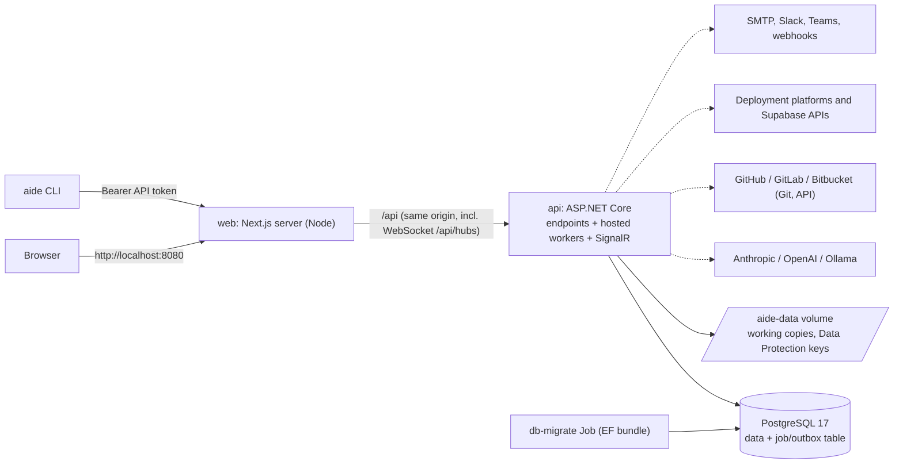

# AIDE Platform

AIDE (AI-Driven Engineering Framework) turns an idea into released software through a governed lifecycle: Refinement, Specification, Planning, Execution, Review, Release. AI agents produce versioned artifacts. People approve them at gates. Every state change is logged and can be rolled back.

Key features (v1):

- Six-phase lifecycle state machine with approval gates (strict, advisory, autonomous).
- Versioned, hash-checked artifacts with diffs, invalidation cascade and integrity alerts.
- Five agents behind one LLM abstraction: Anthropic, OpenAI, Ollama and a deterministic Fake provider.
- Stepwise code generation with an Execution Guardian, Git sync (GitHub or Local), pull request, review cycles, merge and tag.
- Live project updates (SignalR), notifications (in-app, email, Slack, Teams, signed webhooks) and one-click approval links.
- Admin pages (events, runs, dead letters) and the `aide` command-line tool.

Added in v2:

- **Release versions.** Each release has a semver version with internal checkpoints. Rollback is limited to the version in development, and a released version is closed. After a merged release you can start the next version. Two badges show the released and in-development versions.
- **Import an existing repo.** Pick a GitHub repo (or a Local one in E2E) and its released tag. A Repository Analyst writes a codebase summary first.
- **Repo tools for agents.** Read-only `list_files`, `read_file` and `search_code` run on a credential-free snapshot, with limits and secret redaction.
- **Tech stack presets.** `nextjs-supabase` and `nextjs-frontend` added specialist agents per plan step, spec sections, a review checklist and protected paths. v4 retires them (see below).
- **GitHub App.** An Admin registers it through the manifest flow. Background Git work uses short-lived installation tokens. The personal access token stays as a fallback.
- **Per-user LLM connections.** A user adds provider keys, and a project Owner binds one to the project.
- **Merge strategies.** `aide_merges` or `manual`, a merge-poll job, merge readiness, check runs as review input and GitHub Releases.
- **Vercel deployments.** Preview deployments in review and production deployments on release, with promote and redeploy. A deterministic Fake provider covers tests.
- **New UI shell** with a side navigation, one page per lifecycle stage, and full execution and review history. More notification types and `aide` commands for versions and deployments.

Added in v3: AIDE's own frontend moved to Next.js with a custom Node server, and AIDE deploys to Railway (`preview` and `production`).

Added in v4:

- **Stack composition.** The wizard's Stack step picks one option per layer from a versioned catalog adapted from the stack-packs: frontend, backend, data, version control and deployment hosts. Compatibility rules run in the backend, and the wizard only renders their answer. The composition is pinned on the release version. The v2 presets became equivalent compositions in a data migration.
- **Specialist agents with pack skills.** Generic specialists load the skills of the chosen packs. Spec sections, plan rules, protected paths and the review checklist come from the composition.
- **GitLab and Bitbucket Cloud.** Sign-in, connections, repo picker and create, draft MRs/PRs, merge readiness, CI status, release (GitLab Release, or an annotated tag with notes on Bitbucket) and import. GitLab works on gitlab.com or self-managed instances.
- **Deployment platforms.** Vercel, Netlify, Cloudflare (Workers Builds, Pages), GitHub Pages, Render and Railway, set per component (frontend, backend). A platform builds from the repo's Git host. AIDE keeps an environment inventory, a persistent preview environment with preview and production rollouts, rollback where the platform supports it, and an origin model (same-origin, proxy or cross-origin).
- **Managed databases.** Provision, link or enter an external database for Supabase, Render Postgres or Railway Postgres, per environment. Supabase BaaS migrations run through AIDE's own runner just before the merge. ORM migrations run on the platform. Preview databases can be reset, and the preview and production databases must differ.
- **LLM choice.** Providers are enabled per deployment. The wizard chooses provider, connection and model. Calls stream, each model has its own output limit, and a cut-off answer is continued up to 5 times.
- **Events and CLI.** New events and notifications (binding cleared, database expiring, migration failed, target needs attention). The CLI gains stack, deployment, database and migration commands.

`SPEC.md` is the source of truth for behaviour. `CLAUDE.md` holds the conventions. `PROGRESS.md` logs build decisions.

## Stack

AIDE's own stack is unchanged in v4. [`STACK.md`](STACK.md) holds the packs and shared conventions.

| Layer | Summary |
| --- | --- |
| Frontend | Next.js 16 App Router, React 19, TypeScript strict, TanStack Query, Tailwind 4, Vitest and Playwright. A custom Node server serves it and proxies `/api` |
| Backend | ASP.NET Core on .NET 10, minimal APIs, hosted background workers, xUnit v3 |
| Data | EF Core 10 on PostgreSQL 17 (Railway: 18). EF owns the migrations |
| VCS / CI | Git on GitHub, with GitHub Actions |
| Deploy | Railway `preview` and `production`, defined in `.railway/railway.ts` and deployed by GitHub Actions |
| Local | Docker Desktop Kubernetes with Kustomize at http://localhost:8080 |

This is separate from the stack catalog, which describes the stacks of the projects AIDE builds.

## Architecture



- One API process runs the endpoints and the background workers. Workers claim jobs from a PostgreSQL table with `FOR UPDATE SKIP LOCKED`. There is no Redis or message broker (SPEC D1).
- State changes and their follow-up jobs are written in one transaction (outbox).
- Live updates use one SignalR hub, so run a single API replica.
- The frontend calls the API only through the generated client, at same-origin `/api`. The web server (`frontend/server.ts`, a custom Node server around Next.js) proxies it, WebSocket upgrades included, to `BACKEND_URL`. It also sets the security headers and CSP nonce, and logs one redacted JSON line per request, except static assets and `/healthz`.
- On Kubernetes, `deploy-local.sh` runs the `db-migrate` Job (an EF Core bundle in the API image) and waits for it before it updates the API and web pods. A failed migration leaves the running version untouched.

### Repo layout

```
backend/
  src/Aide.Api/             endpoints, auth, ProblemDetails, OpenAPI, hosted workers
  src/Aide.Domain/          pure business rules: state machine, gates, versioning, guardian, review scoring
  src/Aide.Infrastructure/  EF Core (Persistence, Migrations), LLM, Git hosts (GitHub, GitLab, Bitbucket), deployment
                            platforms, databases, notifications, Agents/Prompts and Agents/Stack (embedded catalog)
  src/Aide.Cli/             `aide` .NET global tool
  tests/                    Aide.UnitTests, Aide.IntegrationTests (Testcontainers)
  openapi/api.json          GENERATED contract (committed)
frontend/
  src/api/generated/        GENERATED client
  src/features/             pages, components, hooks per feature
  src/app/                  Next.js App Router routes (thin; render feature pages)
  server.ts                 custom Node server: serves the app, proxies /api
  e2e/                      Playwright
deploy/
  k8s/base, k8s/overlays/local, k8s/overlays/local-e2e   Kustomize manifests
  scripts/                  deploy-local.sh, teardown-local.sh, smoke.sh, validate-manifests.sh, seed-e2e-repo.sh
docs/v1, docs/v2, docs/v3   frozen specs and build logs (docs/v2/brand holds the AIDE logo source)
scripts/ci, scripts/perf    generated-file check, E2E seed for CI, perf scripts (nfr-perf.mjs, v2-perf.mjs)
docker-compose.yml          dev-loop database only
```

Merge and deployment polls are self-deferring jobs in the same table, so a restart resumes them. The stack catalog (`Aide.Infrastructure/Agents/Stack`: `catalog.json`, `packs/`, `agents/`, `core/`) is content-hashed, and each release version pins the composition and catalog version it was built with.

Stack and origin model:

- The Domain owns the compatibility rules. `POST /api/stack/options` and `/validate` serve the wizard, Settings, the API and the CLI.
- The origin model says how the browser reaches the backend: `same-origin`, `proxy` or `cross-origin`. The options depend on the chosen frontend, backend and hosts.
- Database migrations: AIDE itself runs only Supabase BaaS migrations, just before the merge. For ORM stacks, the platform runs the data pack's migrate command (pre-deploy, container start, or the production build when `AIDE_RUN_MIGRATIONS=true`).
- AIDE's own database migrations run as before: the EF bundle, in the `db-migrate` Job or Railway pre-deploy.

Business rules live in `Aide.Domain`. Endpoints stay thin. The contract flows one way: backend build writes `backend/openapi/api.json`, then `npm run gen:api` writes `frontend/src/api/generated/`. Never hand-edit either. See `CLAUDE.md` for the full rules.

## Prerequisites

| Need | Version / note |
| --- | --- |
| .NET SDK | 10.0.401 (`backend/global.json`, roll-forward to the latest feature band) |
| Node.js | 24 (`frontend/.nvmrc`). The web server runs `.ts` files with Node type stripping |
| Docker Desktop | Needed for the dev database, integration tests and image builds |
| Kubernetes | Docker Desktop, Settings, Kubernetes, enable. This provides `kubectl` and the `docker-desktop` context |
| Memory | Give Docker Desktop enough for the cluster, a build, and the pods (limits: api 1 Gi, db 1 Gi, web 128 Mi) |
| `git` | Used by the Local Git provider (the API image installs its own) |
| Optional | `kubeconform`, `oasdiff`, `actionlint`; Playwright browsers (`npx playwright install`) |

Notes on the cluster provisioner: Docker Desktop's default (kubeadm) cluster shares Docker's image store, so built images are visible at once. With the kind provisioner, `deploy-local.sh` detects the containerd runtime and loads the images into the `desktop-control-plane` / `desktop-worker` node containers. Scripts only ever use the `docker-desktop` context.

Connect a database GUI:

- Dev loop: `localhost:5432`, database, user and password from your `.env`.
- Kubernetes: `kubectl --context docker-desktop -n aide port-forward svc/db 15432:5432`, then `localhost:15432`. The user is `aide`. The password is `POSTGRES_PASSWORD` in `deploy/k8s/overlays/local/secrets.env`.

## Dev loop

One-off setup:

```bash
cp .env.example .env                 # pick your own POSTGRES_PASSWORD (git-ignored)
docker compose up -d db              # PostgreSQL 17 on 127.0.0.1:5432
cd backend
dotnet tool restore
dotnet user-secrets set "ConnectionStrings:Aide" "Host=localhost;Port=5432;Database=aide;Username=aide;Password=<POSTGRES_PASSWORD from .env>" --project src/Aide.Api
dotnet ef database update --project src/Aide.Infrastructure --startup-project src/Aide.Api
cd ../frontend && npm ci
```

Each session:

```bash
docker compose up -d db
dotnet run --project backend/src/Aide.Api    # http://localhost:5080
npm --prefix frontend run dev                # http://localhost:3000 (Next.js dev server; proxies /api to BACKEND_URL, default 5080)
```

| What | URL |
| --- | --- |
| App (use this one) | http://localhost:3000 |
| API | http://localhost:5080 |
| Database | localhost:5432 |

The Development environment enables the seed. On first start it creates the Admin `admin@aide.local`, the project "Demo: Todo API" (Fake provider, Local Git, released at `0.1.0`, so you can try "Start new version" at once) and "Demo: Recipe Finder" (a migrated v2 preset project, in planning), plus "Demo: Vue Notes" (Vue + Supabase BaaS, in specification). A v1 database keeps its demo project, and an untouched one is upgraded to a released `0.1.0`. The generated password is logged once at Warning in the `dotnet run` console. Look for `Seeded admin admin@aide.local with password ...`. If you missed it, sign in with another account (the first registered user is Admin) or reset the database volume.

New migration: `dotnet ef migrations add <Name> --project src/Aide.Infrastructure --startup-project src/Aide.Api` (from `backend/`). Never edit a committed migration.

## Local Kubernetes (Docker Desktop)

```bash
./deploy/scripts/deploy-local.sh
```

The script builds the `aide-api` and `aide-web` images, tags them with the git SHA, applies the manifests in two passes, runs the `db-migrate` Job, rolls out `api` and `web`, then runs `smoke.sh`. It is safe to re-run and never deletes data. Run it from the repo root in Git Bash or WSL.

- **App:** http://localhost:8080 (namespace `aide`).
- **web:** the Next.js standalone server (`frontend/server.ts` in the `aide-web` image) on the `web` LoadBalancer Service, port 8080. It serves the pages, sets the security headers and CSP nonce, and proxies `/api` (including the SignalR WebSockets) to `BACKEND_URL=http://api:8080` from the `app-config` ConfigMap. It runs as uid 1000 (`node`) with a read-only root filesystem; only `/tmp` (an emptyDir holding Next's cache) is writable. Probes use `/healthz`, which never calls the API. `TRUST_EDGE_FORWARDED` is not set, because there is no edge proxy in front of it. The API is ClusterIP only.
- **secrets.env:** if `deploy/k8s/overlays/local/secrets.env` is missing, the script copies `secrets.env.example` and generates the database password, the matching connection string and `Approvals__SigningKey`. It is git-ignored. Edit it to add LLM keys, GitHub App or OAuth values, SMTP; then re-run the script. The script refuses to generate a new password while the database volume exists.
- **Seed admin:** `admin@aide.local`. The password is logged once by the pod that creates it (a Warning line, `Seeded admin admin@aide.local with password ...`):
  `kubectl --context docker-desktop -n aide logs deploy/api | grep -i 'Seeded admin'`
  After a redeploy the line is gone. Note it on the first deploy.
- **Logs:** `kubectl --context docker-desktop -n aide logs deploy/api` (also `deploy/web`, `statefulset/db`, `job/db-migrate`). Logs are JSON.
- **Smoke test only:** `./deploy/scripts/smoke.sh` (`deploy-local.sh` runs it at the end; set `BASE_URL` to test another host). It checks:
  - `/healthz` returns `ok`
  - `/` returns 307 (to `/projects`) or 200
  - `/login` returns 200 with a `Content-Security-Policy` that has a `'nonce-…'` source, `X-Frame-Options: DENY` and `X-Content-Type-Options: nosniff`
  - `/api/health/ready` returns 200 through the proxy. Readiness also fails while migrations are pending or if an embedded preset does not load.
- **E2E mode:** `./deploy/scripts/deploy-local.sh --e2e` is the only switch. It applies `deploy/k8s/overlays/local-e2e`: `Deployments__Provider=Fake`, `Databases__Provider=Fake`, `Deployments__AllowFake=true`, `Git__Local__ImportRoot=/data/import` and `Llm__DefaultProvider=fake`. Fake databases mean no real provisioning or migration runner. It also seeds the Local import repo `/data/import/existing-app` (tags `v0.1.0`, `v0.2.0`) with `seed-e2e-repo.sh`. The API logs a warning on every boot while Fake deployments are on. Use it only for Playwright runs.
- **Switch back:** run `./deploy/scripts/deploy-local.sh` again without `--e2e`. The API pod restarts with Vercel deployments and no Local import. The seeded repo stays on the volume, unused.
- **Teardown:** `./deploy/scripts/teardown-local.sh` (no flags) removes workloads, services, config and secrets. It keeps the namespace and the volumes, so data survives.
- **`--wipe-data`:** `./deploy/scripts/teardown-local.sh --wipe-data` also deletes the whole `aide` namespace: the database and the `aide-data` volume (working copies, encryption keys). You must type `aide` to confirm. Saved project secrets cannot be decrypted afterwards.

### Troubleshooting

| Symptom | Cause and fix |
| --- | --- |
| `No 'docker-desktop' kubectl context` | Enable Kubernetes in Docker Desktop settings and wait until it is running |
| `secrets.env is missing but the database volume already exists` | Restore your old `secrets.env`, or run `teardown-local.sh --wipe-data` (deletes all data) |
| `secrets.env has Windows (CRLF) line endings` | Convert the file to LF (`sed -i 's/\r$//' deploy/k8s/overlays/local/secrets.env`) and re-run |
| `still contains the 'change-me' POSTGRES_PASSWORD` | Set a real password that matches the one in `ConnectionStrings__Aide` |
| Migration Job logs `Cannot load library libgssapi_krb5.so.2` | Harmless Npgsql Kerberos probe. Ignore it |
| Seed admin password not in the logs | It is logged only once, by the pod that created the account. Register a new user and promote it (Admin page), or wipe data |
| `429 RATE_LIMITED` on register or login | Limit is 5 per minute per IP. Wait for the `Retry-After` time. Dev loop: set `Auth__RateLimits__RegisterPerMinute` |
| API ignores `Llm__Anthropic__ApiKey` | Old key name. Use `Llm__Providers__Anthropic__ApiKey` (same for OpenAI) |
| Blank `Smtp__Port=` breaks startup | Blank non-string values fail binding. The script comments them out. Leave them unset |
| API refuses to start with the Fake deployment provider | Outside Development it also needs `Deployments__AllowFake=true`. Use `deploy-local.sh --e2e`, which sets both |
| Import E2E cannot find the Local repo | `Git__Local__ImportRoot` is unset. Deploy with `--e2e`, which also seeds `/data/import/existing-app` |
| API pod not ready | Check `kubectl ... logs deploy/api`, `get events`. A failed migration leaves the old pods running |
| `/api/...` returns 502 `UPSTREAM_ERROR` | The web server can't reach the API. Check the `api` pod, and that `BACKEND_URL` in `app-config` is `http://api:8080` |
| web pod crash-loops with `Invalid web server environment` | `BACKEND_URL` (or `PORT`) is not a valid URL or number. Fix it in `deploy/k8s/base/configmap.yaml` and redeploy |

## Deploy to Railway

AIDE runs on Railway as one project with two environments, `preview` and `production`. Each has a public `web`, a
private `api` with a `/data` volume, and its own Postgres 18 (local and CI use 17). The project is defined as code in
[`.railway/railway.ts`](.railway/railway.ts) (`railway config plan` / `apply`). GitHub Actions deploys `preview` after
green CI on `main`, and `production` on manual dispatch. `deploy/scripts/smoke-remote.sh <web-url>` checks each
deploy.

- **Setup and operations:** [`deploy/railway/README.md`](deploy/railway/README.md) covers first-time setup, secrets,
  the first Admin, the smoke account, GitHub App URLs, backups (Postgres **and** the `/data` volume), rollback, and
  costs.
- **Variables:** [`deploy/railway/variables.md`](deploy/railway/variables.md) lists every Railway variable per service,
  and whether it is a literal, a reference or a secret.

## Configuration reference

ASP.NET Core reads `appsettings.json`, `appsettings.Development.json`, user-secrets (Development), then environment variables. In an environment variable, replace `:` with `__` (for example `Llm__Providers__Anthropic__ApiKey`).

- **Dev loop:** non-secrets in `backend/src/Aide.Api/appsettings*.json` or environment variables; secrets with `dotnet user-secrets set "<Key>" "<value>" --project backend/src/Aide.Api` (run from the repo root).
- **Kubernetes:** secrets and any extra key go in `deploy/k8s/overlays/local/secrets.env` (`KEY=value`, no quotes). Non-secrets are in `deploy/k8s/base/configmap.yaml` and `deploy/k8s/overlays/local/app-config-local.yaml`. The API loads both as environment variables. Re-run `deploy-local.sh` after a change.
- **Railway (FR-112):** every variable per service and environment, and whether it is a literal, a reference, a secret or operator-set, is in [`deploy/railway/variables.md`](deploy/railway/variables.md). Literals and references live in [`.railway/railway.ts`](.railway/railway.ts). Secrets and optional values are set per environment in Railway (`railway variable set <NAME> --stdin ...`) and declared `preserve()` in `railway.ts`.

Values are never shown here. "Secret" means: never commit it, set it only through user-secrets, `secrets.env` or Railway variables.

| Key (env var form) | Purpose | Default | Secret |
| --- | --- | --- | --- |
| `ConnectionStrings:Aide` (`ConnectionStrings__Aide`) | PostgreSQL connection | none (required) | yes |
| `POSTGRES_PASSWORD` | Password for the Postgres container (first init only) | none | yes |
| `POSTGRES_DB`, `POSTGRES_USER` | Compose / StatefulSet database name and user | `aide` | no |
| `DataProtection:ApplicationName` | Data Protection app name (keep stable) | `aide` | no |
| `DataProtection:KeysPath` | Key ring directory | `/data/keys` in a container, else `%LOCALAPPDATA%/aide/keys` | no |
| `Workspaces:Root` | Git working copies and local repos | `/data/workspaces` in a container, else `%LOCALAPPDATA%/aide/workspaces` | no |
| `Telemetry:ConsoleExporter` | OpenTelemetry console exporter | `false` (`true` in Development) | no |
| `Seed:Enabled` | Create the seed admin and demo projects | `false` (`true` in Development and the local k8s overlay) | no |
| `App:PublicBaseUrl` | Browser-facing base URL (absolute http(s), validated at start-up): notification links, the GitHub App manifest's callback and setup URLs, PR links back to AIDE | `http://localhost:8080` (`http://localhost:3000` in Development) | no |
| `Approvals:SigningKey` | HMAC key for one-click approval links, at least 32 chars | none: no links are created | yes |
| `Auth:Cookie:SecurePolicy` | Auth cookie `Always`, `SameAsRequest` or `None` | `SameAsRequest` | no |
| `Auth:RateLimits:LoginPerMinute` | Login attempts per IP per minute | `5` | no |
| `Auth:RateLimits:RegisterPerMinute` | Registrations per IP per minute | `5` | no |
| `Live:AllowedOrigins` (`Live__AllowedOrigins__0`, ...) | Extra browser origins allowed on the SignalR hub | empty | no |
| `Jobs:Enabled` | Run the background job worker | `true` | no |
| `Jobs:PollInterval` | Idle poll interval | `00:00:02` | no |
| `Jobs:Concurrency` | Jobs run at once | `4` | no |
| `Jobs:LeaseDuration` | Lease before a stalled job is re-queued | `00:05:00` | no |
| `Llm:DefaultProvider` | `anthropic`, `openai`, `ollama` or `fake` | `anthropic` | no |
| `Llm:RequestTimeout` | Whole provider call, including a streamed answer (FR-161) | `00:30:00` | no |
| `Llm:StreamIdleTimeout` | Fails a streamed call that receives no data for this long (FR-161) | `00:02:00` | no |
| `Llm:KeyCheckTimeout` | Per key check when a connection is added or re-tested (FR-78); a timeout is `UPSTREAM_ERROR` | `00:00:15` | no |
| `Llm:MaxOutputTokens` | Output token limit per call for models **not** in their provider's catalog (and, for Anthropic, whose limit `GET /v1/models/{id}` couldn't report). Listed models use their catalog `MaxOutputTokens` (FR-160). An answer cut off at the limit is continued and joined; one still cut off records the `output_truncated` run warning | `16000` | no |
| `Llm:MaxOutputTokensCeiling` | Optional cap (at least 1) on every call's output token limit, whatever the catalog says (FR-160) | unset | no |
| `Llm:Providers:<Name>:Enabled` | Whether the provider (`Anthropic`, `OpenAI`, `Ollama`, `Fake`) is offered on this deployment (FR-157). A disabled provider is absent from every list, refused on project create and LLM settings (`LLM_PROVIDER_UNAVAILABLE`), and fails the runs of projects still set to it. At least one must be enabled, and `Llm:DefaultProvider` must be one of them. Railway sets `Ollama` and `Fake` to `false` | `true` | no |
| `Llm:Providers:<Name>:Catalog:<n>:Id`, `Name`, `MaxOutputTokens`, `ContextTokens`, `Recommended` | The provider's model catalog (FR-158, §4.24): what the wizard offers and each model's output limit and context window. Shipped in `appsettings.json`; extend it per deployment with the next index (e.g. `Llm__Providers__Anthropic__Catalog__7__Id`). Ids must be unique per provider, `MaxOutputTokens` at least 1. The OpenAI entries (`gpt-6-astra`, `gpt-6.1-sol`: 16,000 output, 400,000 context) are **unverified** placeholders until checked against OpenAI's model docs (SPEC §11 Q5) | see `appsettings.json` | no |
| `Llm:AllowSystemKeys` | Whether the system keys below may be used, and then only for projects with no bound connection (D-V2-5, FR-79). Otherwise runs use the key an Owner bound from Account → Connections | `false` | no |
| `Llm:Providers:Anthropic:ApiKey` | Anthropic system key (used only with `Llm:AllowSystemKeys=true`) | none | yes |
| `Llm:Providers:OpenAI:ApiKey` | OpenAI system key (used only with `Llm:AllowSystemKeys=true`) | none | yes |
| `Llm:Providers:<Name>:BaseUrl` | Endpoint override (`Anthropic`, `OpenAI`, `Ollama`, `Fake`). Ollama: `Llm__Providers__Ollama__BaseUrl` | Ollama: `http://localhost:11434` (Development, no container) or `http://host.docker.internal:11434` (container) | no |
| `Llm:Providers:<Name>:DefaultModel` | Model when an agent has no own entry | see section below | no |
| `Llm:Providers:<Name>:Models:<Agent>` | Model per agent | see section below | no |
| `Llm:Pricing:<model>:InputPerMTok`, `OutputPerMTok` | USD per million tokens, for cost estimates | see appsettings; unpriced = 0 | no |
| `GitHub:App:AppId` | AIDE GitHub App id (FR-80). All five `GitHub:App:*` values together override the App registered from Admin → Integrations → GitHub; set none or all | none: the registered App, if any | no |
| `GitHub:App:ClientId` | The App's client id (sign-in and connections) | none | no |
| `GitHub:App:ClientSecret` | The App's client secret | none | yes |
| `GitHub:App:PrivateKey` | The App's PEM private key; `\n` escapes allowed (one line in `secrets.env`) | none | yes |
| `GitHub:App:Slug` | The App's slug (install link `https://github.com/apps/<slug>/installations/new`) | none | no |
| `GitHub:OAuth:ClientId` | GitHub sign-in OAuth App client id (v1; used only while no GitHub App exists, D-V2-7) | none: sign-in disabled | no (treat as config) |
| `GitHub:OAuth:ClientSecret` | GitHub sign-in OAuth App secret | none | yes |
| `GitHub:GitBaseUrl` | Where repos are cloned from and pushed to | `https://github.com/` | no |
| `GitHub:ApiBaseUrl` | GitHub REST API | `https://api.github.com/` | no |
| `GitHub:ReleaseMergeMethod` | PR merge at release: `merge`, `squash`, `rebase` | `merge` | no |
| `GitLab:AllowPrivateNetworks` | Allow GitLab hosts that resolve to private ranges (10/8, 172.16/12, 192.168/16, fc00::/7, `*.railway.internal`). Loopback, link-local and metadata addresses are always refused (SPEC §8). `false` on Railway | `true` (dev loop and the local k8s overlay) | no |
| `GitLab:Instances:<n>:Name`, `BaseUrl`, `ClientId`, `AllowInsecureHttp` | Config-defined GitLab instance (FR-130), e.g. `GitLab__Instances__0__BaseUrl`. `BaseUrl` empty = `https://gitlab.com`. Overrides a DB-registered instance (Admin → Integrations → Git hosts) with the same host. Validated at start-up. `AllowInsecureHttp` permits a plain-`http` self-managed instance | none: the DB-registered instances only (`AllowInsecureHttp` `false`) | no |
| `GitLab:Instances:<n>:ClientSecret` | That instance's GitLab OAuth application secret | none | yes |
| `GitLab:RequestTimeout` | One GitLab API request | `00:00:20` | no |
| `Bitbucket:OAuth:ClientId` | Bitbucket Cloud OAuth consumer key (FR-133), e.g. `Bitbucket__OAuth__ClientId`. Overrides the consumer saved in Admin → Integrations → Bitbucket. Set together with the secret (validated at start-up) | none: the DB-saved consumer only | no |
| `Bitbucket:OAuth:ClientSecret` | That consumer's secret | none | yes |
| `Bitbucket:RequestTimeout` | One Bitbucket API request | `00:00:20` | no |
| `Git:Local:ImportRoot` | Folder under which a Local import (`git.localSourcePath`) must live. Empty disables Local import. E2E and dev only | unset (`/data/import` in the E2E overlay) | no |
| `Deployments:Provider` | `Vercel` (the real platform APIs of every deployment provider; the name is historical) or `Fake`. Fake makes every deployment check deterministic and lets Local Git projects use deployments | `Vercel` (`Fake` in the E2E overlay) | no |
| `Deployments:AllowFake` | Allows `Fake` (for deployments and databases) outside Development and Testing. Without it the API refuses to start with Fake | `false` (`true` in the E2E overlay) | no |
| `Databases:Provider` | `Platform` or `Fake`. Fake makes database provisioning and the migration runner deterministic, with no network and no real database. Set it with `Deployments:Provider`: each is read on its own | `Platform` (`Fake` in Development and the E2E overlay) | no |
| `Notifications:AllowPrivateTargets` | Let Slack, Teams, webhooks reach private addresses (local testing only) | `false` | no |
| `Notifications:RequestTimeout` | One webhook request, at most 60 s | `00:00:10` | no |
| `Notifications:SweepEnabled` | Run delivery retries and gate reminders | `true` | no |
| `Notifications:DeliverySweepInterval` | How often due retries run | `00:01:00` | no |
| `Notifications:GateSweepInterval` | How often gates are checked for reminders | `01:00:00` | no |
| `Notifications:DatabaseExpirySweepInterval` | How often the `database_expiry_sweep` job is queued: it reads each database's state to raise "database expiring" and mark `expiring`/`paused` (FR-155). Positive | `01:00:00` | no |
| `Notifications:SweepBatchSize` | Deliveries retried per sweep | `50` | no |
| `Smtp:Host` | SMTP server. Blank: email skipped, other channels still send | blank | no |
| `Smtp:Port` | SMTP port | `587` | no |
| `Smtp:Username` | SMTP user | none | no |
| `Smtp:Password` | SMTP password | none | yes |
| `Smtp:From` | Sender address | `aide@aide.local` | no |
| `Smtp:EnableSsl` | TLS for SMTP | `true` | no |
| `Smtp:Timeout` | One whole send, positive and at most `00:01:00` | `00:00:15` | no |
| `BACKEND_URL` | Web server only (`frontend/server.ts`): API origin it proxies `/api` to, WebSocket included | `http://localhost:5080` | no |
| `TRUST_EDGE_FORWARDED` | Web server only: keep the edge's `X-Forwarded-Proto`/`-Host`. `true` on Railway | unset (off) | no |
| `PORT` | Web server listen port (and Railway healthcheck port) | `8080` (`3000` in dev) | no |
| `ForwardedHeaders:ForwardLimit` (`ForwardedHeaders__ForwardLimit`) | Forwarded hops the API trusts. `2` on Railway (edge, web) | `1` | no |
| `ASPNETCORE_ENVIRONMENT` | `Development` (dev loop) or `Production` (k8s) | set by launch profile / configmap | no |
| `ASPNETCORE_FORWARDEDHEADERS_ENABLED` | Trust the web server's `X-Forwarded-*` | `true` in the k8s configmap | no |

`GitHub:AllowInsecureGitBaseUrl` exists for tests only. Do not set it.

Where each value lives:

| Kind | Dev loop | Kubernetes |
| --- | --- | --- |
| Secrets (marked "yes") | `dotnet user-secrets set "<Key>" "<value>" --project backend/src/Aide.Api` | `deploy/k8s/overlays/local/secrets.env`, as `Key__Sub=value` |
| `App:PublicBaseUrl` | `appsettings.Development.json` (`http://localhost:3000`) | `app-config-local.yaml` |
| `Deployments:*`, `Git:Local:ImportRoot`, `Llm:DefaultProvider` for E2E | environment variables | `deploy/k8s/overlays/local-e2e/app-config-e2e.yaml` (`--e2e` only) |
| Other non-secrets | `appsettings*.json` or environment variables | `deploy/k8s/base/configmap.yaml` |

Platform tokens (Vercel, Netlify, Cloudflare, Render, Railway, Supabase), database connection strings, user LLM keys, GitHub, GitLab and Bitbucket user tokens, registered GitLab instances and the Bitbucket consumer, the registered GitHub App and deployment env values are not configuration. They are stored encrypted in the database and are never shown.

### a. GitHub sign-in (OAuth App)

1. GitHub, Settings, Developer settings, OAuth Apps, New OAuth App.
2. Homepage URL: `http://localhost:8080` (Kubernetes) or `http://localhost:3000` (dev loop).
3. Authorization callback URL: `<homepage>/api/auth/github/callback`. The code builds the callback from the host the browser used, so it must match exactly:
   - Kubernetes: `http://localhost:8080/api/auth/github/callback`
   - Dev loop: `http://localhost:3000/api/auth/github/callback` (sign in through the Next.js URL, not 5080)
   If your OAuth App takes only one callback URL, create one app per host.
4. Generate a client secret. Scopes requested: `read:user`, `user:email`.
5. Set `GitHub:OAuth:ClientId` and `GitHub:OAuth:ClientSecret` (dev: user-secrets; k8s: `GitHub__OAuth__ClientId` and `GitHub__OAuth__ClientSecret` in `secrets.env`, then re-run `deploy-local.sh`).

If either value is unset, the "Continue with GitHub" button is hidden and `/api/auth/github*` returns 404. Email and password sign-in still works. A failed sign-in redirects to `/login?error=GITHUB_AUTH_FAILED&reason=<oauth_failed|link_required|already_linked>`. A GitHub email that matches an existing unlinked account is not auto-linked: sign in, then link GitHub on the Account page.

### a2. The AIDE GitHub App (recommended, FR-80)

1. Admin → Integrations → GitHub → Register: AIDE posts a manifest to GitHub (your account or an organisation). The App is named `AIDE (<host of App:PublicBaseUrl>)`, has its webhook off, and asks for Contents, Pull requests, Workflows and Administration (write), Metadata, Checks and Commit statuses (read), and email addresses (read). Untick Administration to disable "Create repository".
2. GitHub redirects back to `/api/admin/integrations/github/callback`; AIDE stores the App id, slug, client id and the client secret and private key encrypted (Data Protection, one purpose per secret). Neither is ever returned.
3. Install the App on the repositories (or organisations) AIDE should use; the install link is on the Integrations page and in the repo picker.

Once an App exists, "Continue with GitHub" uses its user authorization (PKCE) and also connects GitHub (Account → Connections); v1 links keep working because accounts are matched by GitHub user id. Projects default to the `github_app` mode: background Git work uses installation tokens minted per job (scoped to the repository, cached at most 55 minutes, never on disk, in remote URLs or logs), commits are made by `<slug>[bot]`, and the PR links back to the project. Instead of the manifest flow, set all of `GitHub__App__AppId`, `__ClientId`, `__ClientSecret`, `__PrivateKey` and `__Slug` in `secrets.env` (they take precedence). GitHub rate limits answer `429 GITHUB_RATE_LIMITED` with `Retry-After`; background jobs wait for the reset without counting a failed attempt.

### b. GitHub as a project Git provider (personal access token)

- In the project wizard or Settings, Git tab, choose GitHub, enter `https://github.com/OWNER/REPO` and the default branch, then paste a personal access token. The token is stored encrypted and never returned. Use "Test connection" to check it.
- Fine-grained token, on that repository: Contents read and write (clone, push, tag), Pull requests read and write (open, update, merge). Classic token: `repo`.
- Branch protection that blocks the merge will make a release fail. The test reports reachable, writable and default branch present.
- `GitHub:GitBaseUrl`, `GitHub:ApiBaseUrl` and `GitHub:ReleaseMergeMethod` are system settings. A project only supplies owner and repo. Repo URLs must start with `https://github.com/` in v1.

### b2. GitLab (gitlab.com or self-managed, FR-130)

- Register an OAuth application on gitlab.com (User or Group settings → Applications) or on the self-managed instance, with the redirect URI `<App:PublicBaseUrl>/api/auth/gitlab/callback` (`http://localhost:3000/...` in the dev loop, `http://localhost:8080/...` on Docker Desktop, the environment's web URL on Railway) and the scopes Admin → Integrations → Git hosts shows (SPEC §4.19). GitLab labels `http://localhost` URIs "development" but accepts them.
- Then add the instance in Admin → Integrations → Git hosts (stored encrypted), or set `GitLab:Instances:<n>:*` (dev: user-secrets; k8s: the commented `GitLab__Instances__0__*` lines in `secrets.env`, then re-run `deploy-local.sh`; Railway: [deploy/railway/variables.md](deploy/railway/variables.md)). Config wins over a DB row with the same host, and a bad instance stops the API at start-up.
- Hosts on private networks are allowed locally (`GitLab:AllowPrivateNetworks=true`) and refused on Railway (`false`), where those addresses are AIDE's own services.

### b3. Bitbucket Cloud (FR-133)

- Add an OAuth consumer in Bitbucket (Workspace settings → OAuth consumers) with the callback URL `<App:PublicBaseUrl>/api/auth/bitbucket/callback` and the permissions Admin → Integrations → Bitbucket lists: Account, Email, Repositories write and admin, Pull requests write, Projects, Webhooks. Tick "This is a private consumer".
- Save its key and secret in Admin → Integrations → Bitbucket (stored encrypted), or set `Bitbucket:OAuth:ClientId` and `ClientSecret` (dev: user-secrets; k8s: the commented `Bitbucket__OAuth__*` lines in `secrets.env`; Railway: [deploy/railway/variables.md](deploy/railway/variables.md)). Config wins.
- Without a consumer, users can still connect with an Atlassian API token with Bitbucket scopes and their account email (Account → Connections → Bitbucket). App passwords aren't supported.
- AIDE spends at most 900 Bitbucket requests an hour per connection (Bitbucket allows 1,000 per user), held in memory on the single API replica.

### c. Real LLM providers

Without keys, Anthropic and OpenAI need a user connection (Connections) or an allowed system key. A new project gets the configured `Llm:DefaultProvider` when it is enabled and usable by its creator, else the first usable provider in the order Anthropic, OpenAI, Ollama, Fake (SPEC §4.24). Providers can be turned off per deployment with `Llm__Providers__<Name>__Enabled=false`; Railway turns off Ollama and Fake (FR-157).

| Setting | How |
| --- | --- |
| Anthropic | `Llm__Providers__Anthropic__ApiKey` |
| OpenAI | `Llm__Providers__OpenAI__ApiKey` |
| Ollama | `Llm__Providers__Ollama__BaseUrl` (no key). From the cluster it defaults to `http://host.docker.internal:11434` |
| Default provider | `Llm__DefaultProvider` (`anthropic`, `openai`, `ollama`, `fake`) |
| Per project | Settings, LLM tab: provider, model per agent and an optional per-project API key (encrypted, used only for that provider). Base URLs are system-only |

Default model IDs (from `appsettings.json`):

| Provider | Default model | Idea refinement |
| --- | --- | --- |
| Anthropic | `claude-opus-5-5` | `claude-sonnet-5-5` |
| OpenAI | `gpt-6-astra` | `gpt-6.1-sol` |
| Ollama | `qwen2.5-coder` | same as default |
| Fake | `fake-1` | same as default |

Override per agent with `Llm__Providers__<Name>__Models__<Agent>`. Agent names: `IdeaRefinement` and the other `AgentKind` values (names are case-insensitive). Costs come from `Llm:Pricing:<model-id>`. Add an entry for any unpriced model, for example `Llm__Pricing__gpt-6-astra__InputPerMTok`. A project token budget caps total tokens.

### c2. Deployment platforms and managed databases

- Each user adds a token per platform under Account, Connections: Vercel, Netlify, Cloudflare, Render, Railway, and Supabase for databases. The connection dialog lists the token type and permissions to create. AIDE checks the token, stores it encrypted and never shows it again. GitHub Pages uses the GitHub App instead, which needs its Pages permission (update the App in GitHub after upgrading).
- A project Owner binds connections in Settings, Deployment: one target per component (frontend, backend) and one database per environment. AIDE can create the resource or link an existing one. The page shows readiness checks with fix links, the origin model, and the environment inventory. Derived variables (database URLs, Supabase keys, API origin) are written by AIDE.
- A platform must build from the repo's Git host, so some combinations are refused (for example Railway needs GitHub). The stack step shows the reason.
- Review waits for a preview rollout: migrations, then backend, then frontend. A failed build or migration is a critical finding. After the release merge, a production rollout runs the same steps. Rollback appears per platform where supported.
- The preview and production databases must be separate. The Owner can reset the preview database from its card.
- Everything is tested against stub HTTP and the Fake providers only. Real-platform checks are listed in PROGRESS.md "Manual checks". Without accounts, use E2E mode (`Deployments__Provider=Fake`, `Databases__Provider=Fake`).

### c3. Stack composition

Pick one option per layer in the wizard Stack step, or run `aide stack catalog`. An Owner can change the stack until the implementation plan is locked, and again when starting a version. The catalog is data under `backend/src/Aide.Infrastructure/Agents/Stack/`. Each run records the packs and the catalog version. Projects that used v2 presets were converted to equivalent compositions.

### d. Notifications

- **Email:** set `Smtp__Host` plus `Smtp__Username`, `Smtp__Password`, and optionally `Smtp__Port`, `Smtp__From`, `Smtp__EnableSsl`, `Smtp__Timeout` (at most 60 seconds). Without a host, email deliveries are marked skipped and a warning is logged.
- **Approval links:** `Approvals__SigningKey` must be at least 32 characters. `deploy-local.sh` generates it, and replaces a missing, `change-me` or short value. Changing it invalidates links already sent. Without it, notifications link to the project page only.
- **Links in messages:** `App__PublicBaseUrl` is set to `http://localhost:8080` for Kubernetes.
- **Slack, Teams, webhook:** configured per project (Settings, Notifications tab). Webhook URLs are stored encrypted. Targets must be public https hosts. For a receiver on your own machine, set `Notifications__AllowPrivateTargets=true`. Use it for local testing only.
- **Webhook receivers:** a webhook channel needs a signing secret. Each POST has these headers: `X-AIDE-Signature: sha256=<lowercase hex>` (HMAC-SHA256 of the raw body keyed with the secret), `X-AIDE-Timestamp`, `X-AIDE-Delivery`, `X-AIDE-Event` and `Idempotency-Key`. Recompute the HMAC over the raw bytes, compare in constant time, and reject old timestamps.
- **v2 types:** release awaiting merge and deployment failed (Owners), preview ready (members), connection invalid (the connection's owner only, in-app and account email), LLM binding cleared (Owners). Channels opt in to the new events.
- **v4 types (Owners):** Git binding cleared, database provisioning failed, database expiring (7 days before a Render free database expires, or when Supabase pauses a project), migration failed, deployment target needs attention. A channel subscribed to `deployment_failed` also receives `migration_failed`.
- **Retries:** 5 attempts per channel with 1 min, 5 min, 30 min, 2 h backoff. A channel that succeeded is not re-sent.

## Testing

| Suite | Command | Notes |
| --- | --- | --- |
| Backend unit + integration | `cd backend && dotnet test` | Integration tests use Testcontainers, so Docker must run |
| Frontend unit | `cd frontend && npm test` | Vitest, Testing Library, MSW |
| E2E | `cd frontend && npm run test:e2e` | Playwright. Default `BASE_URL` is `http://localhost:3000`; its `webServer` starts `npm run dev` unless `BASE_URL` is set |
| E2E on Kubernetes | `BASE_URL=http://localhost:8080 npm run test:e2e` | Needs a deployed app |
| One browser | `npx playwright test --project=chromium` | Projects: `chromium`, `firefox`, `webkit`, `msedge` (only if Edge is installed or `E2E_MSEDGE=1`), `a11y-setup`, `a11y` |
| Cross-browser | `BASE_URL=http://localhost:8080 npx playwright test --project=firefox --workers=1` | Also `webkit`, `msedge`. Runs the smoke, auth, lifecycle and permissions specs. Use `--workers=1`: registrations are limited to 5 per minute per IP |
| Accessibility | `npx playwright test --project=a11y` | axe, both themes. Admin pages need `E2E_ADMIN_EMAIL` and `E2E_ADMIN_PASSWORD`, otherwise that scan is skipped |
| Performance (v1) | `node scripts/perf/nfr-perf.mjs` | Targets `http://localhost:8080`; set `BASE_URL` to change. Creates a perf user and 50 projects in that database |
| Performance (v2) | `node scripts/perf/v2-perf.mjs` | Project list, execution runs and review cycles p95. Same target and the same side effect: it writes a perf user and projects |

First time: `cd frontend && npx playwright install`. For the dev loop, the API and database must already run. E2E uses the Fake provider and Local Git, so it needs no keys.

The v2 specs (`versions`, `import`, `preset`) need E2E settings. On Kubernetes, deploy with `./deploy/scripts/deploy-local.sh --e2e` first. In the dev loop, start the API with `Deployments__Provider=Fake`, `Deployments__AllowFake=true`, `Llm__DefaultProvider=fake` and `Git__Local__ImportRoot` pointing at a seeded repo (`scripts/ci/seed-e2e-repo-local.sh <dir>` creates `existing-app`; set `AIDE_IMPORT_ROOT` to the same folder for the specs). Registrations are limited to 5 per minute per IP. The specs wait for it.

Regenerate generated files:

```bash
cd backend && dotnet build src/Aide.Api      # writes backend/openapi/api.json
cd frontend && npm run gen:api               # writes src/api/generated/
```

Commit both generated outputs. There is no generated route tree: Next.js discovers routes from `src/app/`.

Full gate. GitHub Actions runs this, plus E2E and image builds, on every push to `main` and `build/**` and on PRs. Agents
don't run it locally: they review first, push to the build branch, and fix until CI is green (see CLAUDE.md "Commit
gate"). On a machine with enough memory for Docker, you can still run it yourself:

```bash
(cd backend && dotnet build -warnaserror && dotnet test && dotnet format --verify-no-changes) && (cd frontend && npm run typecheck && npm run lint && npm test && npm run build) && ./deploy/scripts/validate-manifests.sh
```

## CLI

`aide` is a .NET global tool (`backend/src/Aide.Cli`, package `Aide.Cli`).

```bash
cd backend
dotnet pack src/Aide.Cli -c Release -o ./nupkg
dotnet tool install --global Aide.Cli --add-source ./nupkg      # update: dotnet tool update ...
aide login                                  # prompts for a token, or: aide login --token aide_pat_...
```

Create the token on the Account page of the app (shown once). Then:

| Command | What it does |
| --- | --- |
| `aide projects list` | List your projects (`--search`, `--phase`, `--status`, paging) |
| `aide project init` (alias `create`) | Create a project (like the wizard). A GitHub token is read from `AIDE_GIT_TOKEN` or prompted. LLM flags: `--llm-provider <p> --llm-model <id> [--llm-connection <id>]`; omit them for the server's default |
| `aide status <id>` | Phase, status, released and in-development versions, checkpoint, stack composition, production URLs, latest deployment, latest migration run, artifacts, execution, review, gates. `--json` adds `stack` and `latestMigrationRun` |
| `aide version start <id> <semver> --request <text\|@file> [stack flags]` | Start a new version of a released project (Owner). `@-` reads stdin. Stack flags are those of `aide stack set`, also as `--stack-frontend` etc. `--preset` exits 2: presets were removed in v4 |
| `aide versions <id>` | List release versions |
| `aide stack catalog` | List the catalog's layers and options |
| `aide stack show <id>` | Show a project's composition and whether it is locked |
| `aide stack set <id> [--frontend <opt>] [--backend <opt>] [--data <opt>[:baas]] [--vcs <opt>] [--frontend-host <opt>] [--backend-host <opt>] [--database-host <opt>] [--local compose\|none]` | Change the version in development's stack (Owner). Named layers merge into the current composition; `none` clears a layer. Changing frontend, backend or their hosts resets the origin model, with a warning on stderr. Exit 4 prints `STACK_INCOMPATIBLE` violations or `STACK_LOCKED` |
| `aide stack detect <repo-url> [--provider <p>] [--ref <ref>] [--instance <id>] [--connection <id>]` | Suggest a stack from a connected repo. Nothing is stored. The provider comes from the URL for github.com, gitlab.com and bitbucket.org. A PAT is read from `AIDE_GIT_TOKEN` |
| `aide deployments <id> [--component frontend\|backend] [--env preview\|production]` | List deployments (`--target`/`-t` still works as the old name of `--env`) |
| `aide databases <id>` | List managed databases per environment: provider, status, region, plan, expiry, warnings |
| `aide migrations <id>` | List migration runs, newest first |
| `aide artifact list\|history\|show\|approve\|reject\|edit <id> ...` | Work with artifacts. `type` accepts `spec`, `plan` aliases |
| `aide artifact restore <id> <type> <version>` | Restore an older version as a new draft |
| `aide execute <id> [--pause\|--resume]` | Start, pause or resume execution |
| `aide review <id>` | Start a review cycle |
| `aide release <id>` | Approve the pending pre-release gate, else retry the release |
| `aide rollback <id> <checkpoint> --reason "..."` | Roll back to an earlier checkpoint of the version in development |
| `aide logs <id> [--type] [--follow]` | Activity feed |
| `aide config set\|get\|path`, `aide logout` | Settings and saved token |

Add `--json` for JSON output and `--api-url <url>` to pick a server.

| Setting | Detail |
| --- | --- |
| `AIDE_API_URL` | API base URL. Default `http://localhost:8080` |
| `AIDE_TOKEN` | Token that overrides the saved one |
| `AIDE_CONFIG` | Config file path. Default `%APPDATA%\aide\config.json` or `~/.config/aide/config.json` |
| Precedence | flag, then environment, then config file, then default |

A saved token is bound to the URL it was saved for and is sent only there. Plain `http` is allowed only for localhost, 127.0.0.1 and ::1. Exit codes: 0 success, 1 error, 2 usage, 3 auth (401/403), 4 conflict (409). `STACK_INCOMPATIBLE`, `STACK_LOCKED` and `LLM_PROVIDER_UNAVAILABLE` exit 4; `VCS_MISMATCH` exits 1.

## CI

GitHub Actions (`.github/workflows/ci.yml`) runs on pull requests, pushes to `main` and manual dispatch. Changes only to `docs/**`, `.claude/**` or `*.md` are skipped.

| Job | Checks |
| --- | --- |
| backend | Release build with warnings as errors, `openapi/api.json` up to date, no pending EF model changes, CLI packs, tests (Testcontainers), `dotnet format` |
| frontend | Client regenerated and unchanged, typecheck, lint, tests, build |
| manifests | `validate-manifests.sh`: Kustomize render plus kubeconform for both overlays (`local`, `local-e2e`) |
| scripts | `bash -n` on the shell scripts, shellcheck at error severity |
| images | `api` and `web` images build (no push) |
| e2e | Three shards on `chromium` against the API (E2E mode: Fake LLM, Fake deployments, Local Git with a seeded import repo) and the Next.js dev server: `v1` specs, `v2` specs (versions, import, preset), and `a11y` |

CI uses no secrets and no real LLM, Git host, deployment platform or database access. The Firefox, WebKit and Edge projects and the perf scripts run locally or against Kubernetes. The E2E shards have not yet run on GitHub.
