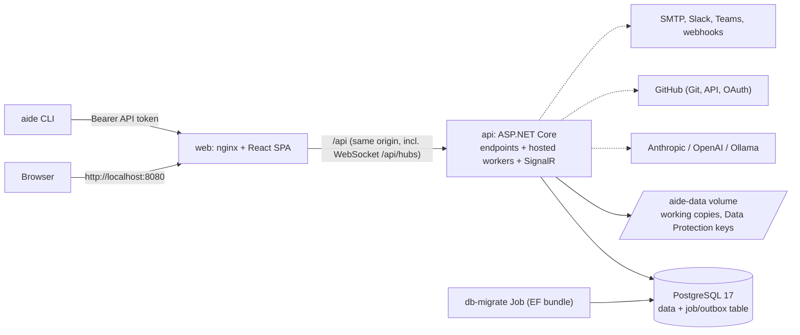

# AIDE Platform

AIDE (AI-Driven Engineering Framework) turns an idea into released software through a governed lifecycle: Refinement, Specification, Planning, Execution, Review, Release. AI agents produce versioned artifacts. People approve them at gates. Every state change is logged and can be rolled back.

Key features:

- Six-phase lifecycle state machine with approval gates (strict, advisory, autonomous) and rollback to any earlier version.
- Versioned, hash-checked artifacts with diffs, invalidation cascade and integrity alerts.
- Five agents behind one LLM abstraction: Anthropic, OpenAI, Ollama and a deterministic Fake provider.
- Stepwise code generation with an Execution Guardian, Git sync (GitHub or Local), pull request, review cycles, merge and tag.
- Live project updates (SignalR), notifications (in-app, email, Slack, Teams, signed webhooks) and one-click approval links.
- Admin pages (events, runs, dead letters) and the `aide` command-line tool.

`SPEC.md` is the source of truth for behaviour. `CLAUDE.md` holds the conventions. `PROGRESS.md` logs build decisions.

## Architecture



- One API process runs the endpoints and the background workers. Workers claim jobs from a PostgreSQL table with `FOR UPDATE SKIP LOCKED`. There is no Redis or message broker (SPEC D1).
- State changes and their follow-up jobs are written in one transaction (outbox).
- Live updates use one SignalR hub, so run a single API replica.
- The SPA calls the API only through the generated client, at same-origin `/api`. Vite proxies it in the dev loop. nginx proxies it on Kubernetes.
- On Kubernetes, `deploy-local.sh` runs the `db-migrate` Job (an EF Core bundle in the API image) and waits for it before it updates the API and web pods. A failed migration leaves the running version untouched.

### Repo layout

```
backend/
  src/Aide.Api/             endpoints, auth, ProblemDetails, OpenAPI, hosted workers
  src/Aide.Domain/          pure business rules: state machine, gates, versioning, guardian, review scoring
  src/Aide.Infrastructure/  EF Core (Persistence, Migrations), LLM and Git providers, notification channels, prompts
  src/Aide.Cli/             `aide` .NET global tool
  tests/                    Aide.UnitTests, Aide.IntegrationTests (Testcontainers)
  openapi/api.json          GENERATED contract (committed)
frontend/
  src/api/generated/        GENERATED client
  src/features/             pages, components, hooks per feature
  src/routes/               TanStack Router file routes
  e2e/                      Playwright
deploy/
  k8s/base, k8s/overlays/local   Kustomize manifests
  scripts/                  deploy-local.sh, teardown-local.sh, smoke.sh, validate-manifests.sh
scripts/ci, scripts/perf    generated-file check, NFR-PERF script
docker-compose.yml          dev-loop database only
```

Business rules live in `Aide.Domain`. Endpoints stay thin. The contract flows one way: backend build writes `backend/openapi/api.json`, then `npm run gen:api` writes `frontend/src/api/generated/`. Never hand-edit either. See `CLAUDE.md` for the full rules.

## Prerequisites

| Need | Version / note |
| --- | --- |
| .NET SDK | 10.0.401 (`backend/global.json`, roll-forward to the latest feature band) |
| Node.js | 24 (`frontend/.nvmrc`) |
| Docker Desktop | Needed for the dev database, integration tests and image builds |
| Kubernetes | Docker Desktop, Settings, Kubernetes, enable. This provides `kubectl` and the `docker-desktop` context |
| Memory | Give Docker Desktop enough for the cluster, a build, and the pods (limits: api 1 Gi, db 1 Gi, web 128 Mi) |
| `git` | Used by the Local Git provider (the API image installs its own) |
| Optional | `kubeconform`, `oasdiff`, `actionlint`; Playwright browsers (`npx playwright install`) |

Notes on the cluster provisioner: Docker Desktop's default (kubeadm) cluster shares Docker's image store, so built images are visible at once. With the kind provisioner, `deploy-local.sh` detects the containerd runtime and loads the images into the `desktop-control-plane` / `desktop-worker` node containers. Scripts only ever use the `docker-desktop` context.

Connect a database GUI:

- Dev loop: `localhost:5432`, database, user and password from your `.env`.
- Kubernetes: `kubectl --context docker-desktop -n aide port-forward svc/db 15432:5432`, then `localhost:15432`. The user is `aide`. The password is `POSTGRES_PASSWORD` in `deploy/k8s/overlays/local/secrets.env`.

## Dev loop

One-off setup:

```bash
cp .env.example .env                 # pick your own POSTGRES_PASSWORD (git-ignored)
docker compose up -d db              # PostgreSQL 17 on 127.0.0.1:5432
cd backend
dotnet tool restore
dotnet user-secrets set "ConnectionStrings:Aide" "Host=localhost;Port=5432;Database=aide;Username=aide;Password=<POSTGRES_PASSWORD from .env>" --project src/Aide.Api
dotnet ef database update --project src/Aide.Infrastructure --startup-project src/Aide.Api
cd ../frontend && npm ci
```

Each session:

```bash
docker compose up -d db
dotnet run --project backend/src/Aide.Api    # http://localhost:5080
npm --prefix frontend run dev                # http://localhost:5173 (proxies /api to 5080)
```

| What | URL |
| --- | --- |
| App (use this one) | http://localhost:5173 |
| API | http://localhost:5080 |
| Database | localhost:5432 |

The Development environment enables the seed. On first start it creates the Admin `admin@aide.local` and the project "Demo: Todo API" (Fake provider, Local Git). The generated password is logged once at Warning in the `dotnet run` console. Look for `Seeded admin admin@aide.local with password ...`. If you missed it, sign in with another account (the first registered user is Admin) or reset the database volume.

New migration: `dotnet ef migrations add <Name> --project src/Aide.Infrastructure --startup-project src/Aide.Api` (from `backend/`). Never edit a committed migration.

## Local Kubernetes (Docker Desktop)

```bash
./deploy/scripts/deploy-local.sh
```

The script builds the `aide-api` and `aide-web` images, tags them with the git SHA, applies the manifests in two passes, runs the `db-migrate` Job, rolls out `api` and `web`, then runs `smoke.sh`. It is safe to re-run and never deletes data. Run it from the repo root in Git Bash or WSL.

- **App:** http://localhost:8080 (namespace `aide`).
- **secrets.env:** if `deploy/k8s/overlays/local/secrets.env` is missing, the script copies `secrets.env.example` and generates the database password, the matching connection string and `Approvals__SigningKey`. It is git-ignored. Edit it to add LLM keys, GitHub OAuth, SMTP; then re-run the script. The script refuses to generate a new password while the database volume exists.
- **Seed admin:** `admin@aide.local`. The password is logged once by the pod that creates it:
  `kubectl --context docker-desktop -n aide logs deploy/api | grep -i 'Seeded admin'`
  After a redeploy the line is gone. Note it on the first deploy.
- **Logs:** `kubectl --context docker-desktop -n aide logs deploy/api` (also `deploy/web`, `statefulset/db`, `job/db-migrate`). Logs are JSON.
- **Smoke test only:** `./deploy/scripts/smoke.sh` (checks `/`, a SPA route and `/api/health/ready`).
- **Teardown:** `./deploy/scripts/teardown-local.sh` removes workloads, services, config and secrets. It keeps the namespace and the volumes, so data survives.
- **`--wipe-data`:** `./deploy/scripts/teardown-local.sh --wipe-data` also deletes the whole `aide` namespace: the database and the `aide-data` volume (working copies, encryption keys). You must type `aide` to confirm. Saved project secrets cannot be decrypted afterwards.

### Troubleshooting

| Symptom | Cause and fix |
| --- | --- |
| `No 'docker-desktop' kubectl context` | Enable Kubernetes in Docker Desktop settings and wait until it is running |
| `secrets.env is missing but the database volume already exists` | Restore your old `secrets.env`, or run `teardown-local.sh --wipe-data` (deletes all data) |
| `secrets.env has Windows (CRLF) line endings` | Convert the file to LF (`sed -i 's/\r$//' deploy/k8s/overlays/local/secrets.env`) and re-run |
| `still contains the 'change-me' POSTGRES_PASSWORD` | Set a real password that matches the one in `ConnectionStrings__Aide` |
| Migration Job logs `Cannot load library libgssapi_krb5.so.2` | Harmless Npgsql Kerberos probe. Ignore it |
| Seed admin password not in the logs | It is logged only once, by the pod that created the account. Register a new user and promote it (Admin page), or wipe data |
| `429 RATE_LIMITED` on register or login | Limit is 5 per minute per IP. Wait for the `Retry-After` time. Dev loop: set `Auth__RateLimits__RegisterPerMinute` |
| API ignores `Llm__Anthropic__ApiKey` | Old key name. Use `Llm__Providers__Anthropic__ApiKey` (same for OpenAI) |
| Blank `Smtp__Port=` breaks startup | Blank non-string values fail binding. The script comments them out. Leave them unset |
| API pod not ready | Check `kubectl ... logs deploy/api`, `get events`. A failed migration leaves the old pods running |

## Configuration reference

ASP.NET Core reads `appsettings.json`, `appsettings.Development.json`, user-secrets (Development), then environment variables. In an environment variable, replace `:` with `__` (for example `Llm__Providers__Anthropic__ApiKey`).

- **Dev loop:** non-secrets in `backend/src/Aide.Api/appsettings*.json` or environment variables; secrets with `dotnet user-secrets set "<Key>" "<value>" --project backend/src/Aide.Api` (run from the repo root).
- **Kubernetes:** secrets and any extra key go in `deploy/k8s/overlays/local/secrets.env` (`KEY=value`, no quotes). Non-secrets are in `deploy/k8s/base/configmap.yaml` and `deploy/k8s/overlays/local/app-config-local.yaml`. The API loads both as environment variables. Re-run `deploy-local.sh` after a change.

Values are never shown here. "Secret" means: never commit it, set it only through user-secrets or `secrets.env`.

| Key (env var form) | Purpose | Default | Secret |
| --- | --- | --- | --- |
| `ConnectionStrings:Aide` (`ConnectionStrings__Aide`) | PostgreSQL connection | none (required) | yes |
| `POSTGRES_PASSWORD` | Password for the Postgres container (first init only) | none | yes |
| `POSTGRES_DB`, `POSTGRES_USER` | Compose / StatefulSet database name and user | `aide` | no |
| `DataProtection:ApplicationName` | Data Protection app name (keep stable) | `aide` | no |
| `DataProtection:KeysPath` | Key ring directory | `/data/keys` in a container, else `%LOCALAPPDATA%/aide/keys` | no |
| `Workspaces:Root` | Git working copies and local repos | `/data/workspaces` in a container, else `%LOCALAPPDATA%/aide/workspaces` | no |
| `Telemetry:ConsoleExporter` | OpenTelemetry console exporter | `false` (`true` in Development) | no |
| `Seed:Enabled` | Create the seed admin and demo project | `false` (`true` in Development and the local k8s overlay) | no |
| `App:PublicBaseUrl` | Base URL for links in notifications | `http://localhost:8080` (`http://localhost:5173` in Development) | no |
| `Approvals:SigningKey` | HMAC key for one-click approval links, at least 32 chars | none: no links are created | yes |
| `Auth:Cookie:SecurePolicy` | Auth cookie `Always`, `SameAsRequest` or `None` | `SameAsRequest` | no |
| `Auth:RateLimits:LoginPerMinute` | Login attempts per IP per minute | `5` | no |
| `Auth:RateLimits:RegisterPerMinute` | Registrations per IP per minute | `5` | no |
| `Live:AllowedOrigins` (`Live__AllowedOrigins__0`, ...) | Extra browser origins allowed on the SignalR hub | empty | no |
| `Jobs:Enabled` | Run the background job worker | `true` | no |
| `Jobs:PollInterval` | Idle poll interval | `00:00:02` | no |
| `Jobs:Concurrency` | Jobs run at once | `4` | no |
| `Jobs:LeaseDuration` | Lease before a stalled job is re-queued | `00:05:00` | no |
| `Llm:DefaultProvider` | `anthropic`, `openai`, `ollama` or `fake` | `anthropic` | no |
| `Llm:RequestTimeout` | Per provider call | `00:05:00` | no |
| `Llm:MaxOutputTokens` | Output token cap per call | `16000` | no |
| `Llm:Providers:Anthropic:ApiKey` | Anthropic key | none | yes |
| `Llm:Providers:OpenAI:ApiKey` | OpenAI key | none | yes |
| `Llm:Providers:<Name>:BaseUrl` | Endpoint override (`Anthropic`, `OpenAI`, `Ollama`, `Fake`). Ollama: `Llm__Providers__Ollama__BaseUrl` | Ollama: `http://localhost:11434` (Development, no container) or `http://host.docker.internal:11434` (container) | no |
| `Llm:Providers:<Name>:DefaultModel` | Model when an agent has no own entry | see section below | no |
| `Llm:Providers:<Name>:Models:<Agent>` | Model per agent | see section below | no |
| `Llm:Pricing:<model>:InputPerMTok`, `OutputPerMTok` | USD per million tokens, for cost estimates | see appsettings; unpriced = 0 | no |
| `GitHub:OAuth:ClientId` | GitHub sign-in OAuth App client id | none: sign-in disabled | no (treat as config) |
| `GitHub:OAuth:ClientSecret` | GitHub sign-in OAuth App secret | none | yes |
| `GitHub:GitBaseUrl` | Where repos are cloned from and pushed to | `https://github.com/` | no |
| `GitHub:ApiBaseUrl` | GitHub REST API | `https://api.github.com/` | no |
| `GitHub:ReleaseMergeMethod` | PR merge at release: `merge`, `squash`, `rebase` | `merge` | no |
| `Notifications:AllowPrivateTargets` | Let Slack, Teams, webhooks reach private addresses (local testing only) | `false` | no |
| `Notifications:RequestTimeout` | One webhook request, at most 60 s | `00:00:10` | no |
| `Notifications:SweepEnabled` | Run delivery retries and gate reminders | `true` | no |
| `Notifications:DeliverySweepInterval` | How often due retries run | `00:01:00` | no |
| `Notifications:GateSweepInterval` | How often gates are checked for reminders | `01:00:00` | no |
| `Notifications:SweepBatchSize` | Deliveries retried per sweep | `50` | no |
| `Smtp:Host` | SMTP server. Blank: email skipped, other channels still send | blank | no |
| `Smtp:Port` | SMTP port | `587` | no |
| `Smtp:Username` | SMTP user | none | no |
| `Smtp:Password` | SMTP password | none | yes |
| `Smtp:From` | Sender address | `aide@aide.local` | no |
| `Smtp:EnableSsl` | TLS for SMTP | `true` | no |
| `Smtp:Timeout` | One whole send, positive and at most `00:01:00` | `00:00:15` | no |
| `ASPNETCORE_ENVIRONMENT` | `Development` (dev loop) or `Production` (k8s) | set by launch profile / configmap | no |
| `ASPNETCORE_FORWARDEDHEADERS_ENABLED` | Trust nginx `X-Forwarded-*` | `true` in the k8s configmap | no |

`GitHub:AllowInsecureGitBaseUrl` exists for tests only. Do not set it.

### a. GitHub sign-in (OAuth App)

1. GitHub, Settings, Developer settings, OAuth Apps, New OAuth App.
2. Homepage URL: `http://localhost:8080` (Kubernetes) or `http://localhost:5173` (dev loop).
3. Authorization callback URL: `<homepage>/api/auth/github/callback`. The code builds the callback from the host the browser used, so it must match exactly:
   - Kubernetes: `http://localhost:8080/api/auth/github/callback`
   - Dev loop: `http://localhost:5173/api/auth/github/callback` (sign in through the Vite URL, not 5080)
   If your OAuth App takes only one callback URL, create one app per host.
4. Generate a client secret. Scopes requested: `read:user`, `user:email`.
5. Set `GitHub:OAuth:ClientId` and `GitHub:OAuth:ClientSecret` (dev: user-secrets; k8s: `GitHub__OAuth__ClientId` and `GitHub__OAuth__ClientSecret` in `secrets.env`, then re-run `deploy-local.sh`).

If either value is unset, the "Continue with GitHub" button is hidden and `/api/auth/github*` returns 404. Email and password sign-in still works. A failed sign-in redirects to `/login?error=GITHUB_AUTH_FAILED&reason=<oauth_failed|link_required|already_linked>`. A GitHub email that matches an existing unlinked account is not auto-linked: sign in, then link GitHub on the Account page.

### b. GitHub as a project Git provider

- In the project wizard or Settings, Git tab, choose GitHub, enter `https://github.com/OWNER/REPO` and the default branch, then paste a personal access token. The token is stored encrypted and never returned. Use "Test connection" to check it.
- Fine-grained token, on that repository: Contents read and write (clone, push, tag), Pull requests read and write (open, update, merge). Classic token: `repo`.
- Branch protection that blocks the merge will make a release fail. The test reports reachable, writable and default branch present.
- `GitHub:GitBaseUrl`, `GitHub:ApiBaseUrl` and `GitHub:ReleaseMergeMethod` are system settings. A project only supplies owner and repo. Repo URLs must start with `https://github.com/` in v1.

### c. Real LLM providers

Without keys, new projects and the seed default to the Fake provider, and Anthropic and OpenAI show "not configured".

| Setting | How |
| --- | --- |
| Anthropic | `Llm__Providers__Anthropic__ApiKey` |
| OpenAI | `Llm__Providers__OpenAI__ApiKey` |
| Ollama | `Llm__Providers__Ollama__BaseUrl` (no key). From the cluster it defaults to `http://host.docker.internal:11434` |
| Default provider | `Llm__DefaultProvider` (`anthropic`, `openai`, `ollama`, `fake`) |
| Per project | Settings, LLM tab: provider, model per agent and an optional per-project API key (encrypted, used only for that provider). Base URLs are system-only |

Default model IDs (from `appsettings.json`):

| Provider | Default model | Idea refinement |
| --- | --- | --- |
| Anthropic | `claude-opus-5-5` | `claude-sonnet-5-5` |
| OpenAI | `gpt-6-astra` | `gpt-6.1-sol` |
| Ollama | `qwen2.5-coder` | same as default |
| Fake | `fake-1` | same as default |

Override per agent with `Llm__Providers__<Name>__Models__<Agent>`. Agent names: `IdeaRefinement` and the other `AgentKind` values (names are case-insensitive). Costs come from `Llm:Pricing:<model-id>`. Add an entry for any unpriced model, for example `Llm__Pricing__gpt-6-astra__InputPerMTok`. A project token budget caps total tokens.

### d. Notifications

- **Email:** set `Smtp__Host` plus `Smtp__Username`, `Smtp__Password`, and optionally `Smtp__Port`, `Smtp__From`, `Smtp__EnableSsl`, `Smtp__Timeout` (at most 60 seconds). Without a host, email deliveries are marked skipped and a warning is logged.
- **Approval links:** `Approvals__SigningKey` must be at least 32 characters. `deploy-local.sh` generates it, and replaces a missing, `change-me` or short value. Changing it invalidates links already sent. Without it, notifications link to the project page only.
- **Links in messages:** `App__PublicBaseUrl` is set to `http://localhost:8080` for Kubernetes.
- **Slack, Teams, webhook:** configured per project (Settings, Notifications tab). Webhook URLs are stored encrypted. Targets must be public https hosts. For a receiver on your own machine, set `Notifications__AllowPrivateTargets=true`. Use it for local testing only.
- **Webhook receivers:** a webhook channel needs a signing secret. Each POST has these headers: `X-AIDE-Signature: sha256=<lowercase hex>` (HMAC-SHA256 of the raw body keyed with the secret), `X-AIDE-Timestamp`, `X-AIDE-Delivery`, `X-AIDE-Event` and `Idempotency-Key`. Recompute the HMAC over the raw bytes, compare in constant time, and reject old timestamps.
- **Retries:** 5 attempts per channel with 1 min, 5 min, 30 min, 2 h backoff. A channel that succeeded is not re-sent.

## Testing

| Suite | Command | Notes |
| --- | --- | --- |
| Backend unit + integration | `cd backend && dotnet test` | Integration tests use Testcontainers, so Docker must run |
| Frontend unit | `cd frontend && npm test` | Vitest, Testing Library, MSW |
| E2E | `cd frontend && npm run test:e2e` | Playwright. Starts `npm run dev` unless `BASE_URL` is set |
| E2E on Kubernetes | `BASE_URL=http://localhost:8080 npm run test:e2e` | Needs a deployed app |
| One browser | `npx playwright test --project=chromium` | Projects: `chromium`, `firefox`, `webkit`, `msedge` (only if Edge is installed or `E2E_MSEDGE=1`), `a11y-setup`, `a11y` |
| Performance | `node scripts/perf/nfr-perf.mjs` | Targets `http://localhost:8080`; set `BASE_URL` to change. Creates a perf user and 50 projects in that database |

First time: `cd frontend && npx playwright install`. For the dev loop, the API and database must already run. E2E uses the Fake provider and Local Git, so it needs no keys. Registrations are limited to 5 per minute per IP. The specs wait for it.

Regenerate generated files:

```bash
cd backend && dotnet build src/Aide.Api      # writes backend/openapi/api.json
cd frontend && npm run gen:api               # writes src/api/generated/
```

`src/routeTree.gen.ts` is rewritten by `npm run dev` and `npm run build`. Commit all three.

Full gate (run before every commit):

```bash
(cd backend && dotnet build -warnaserror && dotnet test && dotnet format --verify-no-changes) && (cd frontend && npm run typecheck && npm run lint && npm test && npm run build) && ./deploy/scripts/validate-manifests.sh
```

## CLI

`aide` is a .NET global tool (`backend/src/Aide.Cli`, package `Aide.Cli`).

```bash
cd backend
dotnet pack src/Aide.Cli -c Release -o ./nupkg
dotnet tool install --global Aide.Cli --add-source ./nupkg      # update: dotnet tool update ...
aide login                                  # prompts for a token, or: aide login --token aide_pat_...
```

Create the token on the Account page of the app (shown once). Then:

| Command | What it does |
| --- | --- |
| `aide projects list` | List your projects (`--search`, `--phase`, `--status`, paging) |
| `aide project init` | Create a project (like the wizard). A GitHub token is read from `AIDE_GIT_TOKEN` or prompted |
| `aide status <id>` | Phase, status, version, artifacts, execution, review, gates |
| `aide artifact list\|history\|show\|approve\|reject\|edit <id> ...` | Work with artifacts. `type` accepts `spec`, `plan` aliases |
| `aide execute <id> [--pause\|--resume]` | Start, pause or resume execution |
| `aide review <id>` | Start a review cycle |
| `aide release <id>` | Approve the pending pre-release gate, else retry the release |
| `aide rollback <id> <version> --reason "..."` | Roll back to an earlier version |
| `aide logs <id> [--type] [--follow]` | Activity feed |
| `aide config set\|get\|path`, `aide logout` | Settings and saved token |

Add `--json` for JSON output and `--api-url <url>` to pick a server.

| Setting | Detail |
| --- | --- |
| `AIDE_API_URL` | API base URL. Default `http://localhost:8080` |
| `AIDE_TOKEN` | Token that overrides the saved one |
| `AIDE_CONFIG` | Config file path. Default `%APPDATA%\aide\config.json` or `~/.config/aide/config.json` |
| Precedence | flag, then environment, then config file, then default |

A saved token is bound to the URL it was saved for and is sent only there. Plain `http` is allowed only for localhost, 127.0.0.1 and ::1. Exit codes: 0 success, 1 error, 2 usage, 3 auth (401/403), 4 conflict (409).

## CI

GitHub Actions (`.github/workflows/ci.yml`) runs on pull requests, pushes to `main` and manual dispatch. Doc-only changes are skipped.

| Job | Checks |
| --- | --- |
| backend | Release build with warnings as errors, `openapi/api.json` up to date, no pending EF model changes, CLI packs, tests (Testcontainers), `dotnet format` |
| frontend | Client regenerated and unchanged, typecheck, lint, tests, build, route tree unchanged |
| manifests | `validate-manifests.sh`: Kustomize render plus kubeconform |
| images | `api` and `web` images build (no push) |
| e2e | Playwright `chromium` project against the API (Fake LLM, Local Git) and Vite |

CI uses no secrets and no real LLM or GitHub access. The Firefox, WebKit, Edge and a11y projects run locally or against Kubernetes.
