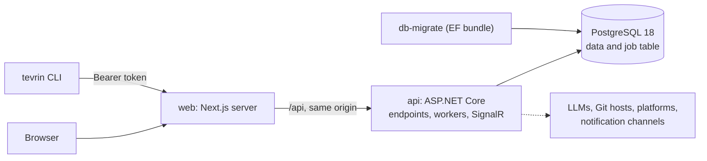

<p align="center">
  
  
</p>

# Tevrin

Tevrin coordinates specialised AI agents through a governed software lifecycle: Refinement, Specification, Planning, Execution, Review and Release. It turns an idea into released software with versioned artifacts, approval gates, rollback and a full audit trail, for engineers and project owners who want AI-driven delivery with deterministic state. Source available on GitHub. Tevrin was called AIDE before v6, and some internal identifiers keep that name.

Documentation: <https://benfielder1.github.io/AI-Driven-Engineering-Platform/>

## Features

- Six-phase lifecycle state machine with strict, advisory or autonomous approval gates.
- Versioned, hash-checked artifacts with diffs, rollback and release versions.
- Specialist agents behind one LLM abstraction: Anthropic, OpenAI, Ollama and a deterministic Fake provider.
- Stepwise code generation, pull or merge requests, review cycles, merge and tag on GitHub, GitLab or Bitbucket.
- Stack composition from a versioned catalog, plus stack inference for existing repos.
- Deployments to Vercel, Netlify, Cloudflare, GitHub Pages, Render and Railway, with managed databases.
- Issue tracker imports from Jira, Linear, GitHub and GitLab.
- Live updates, notifications (in-app, email, Slack, Teams, signed webhooks) and the `tevrin` command-line tool.

## Stack

Tevrin's own stack. [`STACK.md`](STACK.md) holds the packs and shared conventions.

| Layer | Summary |
| --- | --- |
| Frontend | Next.js 16 App Router, React 19, TypeScript strict, TanStack Query, Tailwind 4, Vitest and Playwright. A custom Node server serves it and proxies `/api` |
| Backend | ASP.NET Core on .NET 10, minimal APIs, hosted background workers, xUnit v3 |
| Data | EF Core 10 on PostgreSQL 18. EF owns the migrations |
| VCS / CI | Git on GitHub, with GitHub Actions |
| Deploy | Railway `preview` and `production`, defined in `.railway/railway.ts` and deployed by GitHub Actions |
| Local | Docker Desktop Kubernetes with Kustomize at http://localhost:8080 |
| Docs | Jekyll with the just-the-docs theme, published to GitHub Pages |

## Architecture



- One API process runs the endpoints and the background workers. Workers claim jobs from a PostgreSQL table. There is no Redis or broker.
- The frontend calls the API only through the generated client, at same-origin `/api`. The web server proxies it, WebSockets included.
- Business rules live in `Aide.Domain`: pure and unit-tested. Endpoints stay thin.
- The contract flows one way: the backend build writes `backend/openapi/api.json`, then `npm run gen:api` writes the client. Never hand-edit either.
- Schema changes are EF Core migrations, run by a bundle before the new version starts.
- Internal identifiers keep the `aide` name (`Aide.*`, the database, cookies, `aide_pat_` tokens).

## Repo layout

```
backend/    src/Aide.Api, Aide.Domain, Aide.Infrastructure, Aide.Cli · tests/ · openapi/api.json (generated)
frontend/   src/app, src/features, src/api/generated (generated) · server.ts · e2e/
deploy/     k8s/ (Kustomize) · scripts/ · railway/ (ops docs)
.railway/   Railway infrastructure as code
.github/    workflows: ci.yml, deploy.yml, docs.yml
docs/       the docs site, and frozen specs in docs/v1 to docs/v5
SPEC.md · PROGRESS.md · STACK.md · CLAUDE.md
```

## Deployment

**Railway.** One project with `preview` and `production` environments, each with a public `web`, a private `api` and its own Postgres 18. GitHub Actions deploys `preview` after green CI on `main`, and `production` on manual dispatch. See [Railway](docs/operations/railway.md).

**Local Kubernetes.** `./deploy/scripts/deploy-local.sh` builds the images and runs the full app on the Docker Desktop cluster at http://localhost:8080. See [Local Kubernetes](docs/operations/local-kubernetes.md). To develop, start with the [dev loop](docs/getting-started/dev-loop.md).

## Documentation

| Section | What is in it |
| --- | --- |
| [Overview](docs/index.md) | What Tevrin is and where to start |
| [Getting started](docs/getting-started/index.md) | Prerequisites, dev loop, your first project |
| [Guides](docs/guides/index.md) | Connections, GitHub App, GitLab, Bitbucket, LLM providers, trackers, stacks, deployments, notifications, CLI |
| [Operations](docs/operations/index.md) | Local Kubernetes, Railway, PostgreSQL 17 to 18 upgrade, CI |
| [Reference](docs/reference/index.md) | Configuration, API, architecture, testing, error codes, repo layout |
| [History](docs/history/index.md) | Specs and build logs for v1 to v6 |
| [Brand](docs/brand.md) | Logo files, colours, usage rules |

[`SPEC.md`](SPEC.md) is the source of truth for behaviour, [`CLAUDE.md`](CLAUDE.md) holds the conventions, and [`PROGRESS.md`](PROGRESS.md) logs build decisions.
