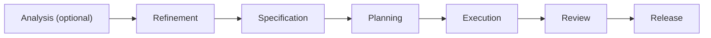

# Your first project

## 1. Sign in

Open the app. In the dev loop the seed creates the Admin `admin@aide.local` and logs its password once. Otherwise register: the first registered user becomes Admin. On a fresh install, the Home page shows a checklist: connect a Git host, add an AI provider, create or import a project, and optionally connect a deployment platform.

## 2. Connect what you need

Under **Account, Connections**, add a Git host and an LLM key. For a quick try, the seeded demo projects use the deterministic Fake LLM and Local Git, so they need no keys. See [Connections and sign-in](../guides/connections.md) and [LLM providers](../guides/llm-providers.md).

## 3. Create a project

Choose **New project** and follow the wizard: describe the idea, pick a stack (or infer it from an existing repo), choose the Git host and LLM, and decide how gates work. To import an existing repo, pick it and its released tag.

## 4. Move it through the lifecycle

A project moves through Refinement, Specification, Planning, Execution, Review and Release. A project that infers its stack starts in Analysis first.

- AI agents produce versioned artifacts at each phase.
- People approve artifacts at **gates**. The approval mode is strict, advisory or autonomous.
- Locked artifacts never change. New content is a new version with a content hash.
- Every state change is logged, and you can roll back to an earlier checkpoint of the version in development.

After a merged release you can start the next version.

## Follow a run: Pipeline, Replay and Gates

- **Pipeline tab.** Each project has a Pipeline tab showing the current run: its status, checkpoint, cost and tokens so far, the stages with their timings, a timeline, and the artifacts with their versions and diffs. A picker switches to earlier runs. A "Prompt versions" table compares prompt versions by runs, tokens, cost, latency and failure rate.
- **Replay.** From the Pipeline tab, Replay steps through a run one event at a time. Each agent run shows its input and output side by side, and each artifact version shows its diff to the previous one. Replay only reads; it never re-runs anything. Agent inputs are stored with secrets redacted and are kept only for runs from 0.7.0 on.
- **Gate inbox.** **Gates** in the navigation lists every approval waiting for you across the projects you can see. Approve or reject from the list. The reject comment is optional. Escalations open the project instead.

These views work for any pipeline definition, not only the software lifecycle. See [Pipelines and packs](../guides/pipelines-and-packs.md).

## Where next

| To | Read |
| --- | --- |
| Choose a stack | [Stacks and inference](../guides/stacks-and-inference.md) |
| Deploy what you build | [Deployments and databases](../guides/deployments-and-databases.md) |
| Get notified at gates | [Notifications](../guides/notifications.md) |
| Script it | [API tokens](../reference/api-and-contract.md#create-an-api-token) |
