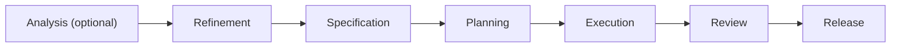

# Your first project

## 1. Sign in

Open the app. In the dev loop the seed creates the Admin `admin@aide.local` and logs its password once. Otherwise register: the first registered user becomes Admin. On a fresh install, the Home page shows a checklist: connect a Git host, add an AI provider, create or import a project, and optionally connect a deployment platform.

## 2. Connect what you need

Under **Account, Connections**, add a Git host and an LLM key. For a quick try, the seeded demo projects use the deterministic Fake LLM and Local Git, so they need no keys. See [Connections and sign-in](../guides/connections.md) and [LLM providers](../guides/llm-providers.md).

## 3. Create a project

Choose **New project** and follow the wizard: describe the idea, pick a stack (or infer it from an existing repo), choose the Git host and LLM, and decide how gates work. To import an existing repo, pick it and its released tag.

## 4. Move it through the lifecycle

A project moves through Refinement, Specification, Planning, Execution, Review and Release. A project that infers its stack starts in Analysis first.

- AI agents produce versioned artifacts at each phase.
- People approve artifacts at **gates**. The approval mode is strict, advisory or autonomous.
- Locked artifacts never change. New content is a new version with a content hash.
- Every state change is logged, and you can roll back to an earlier checkpoint of the version in development.

After a merged release you can start the next version.

## Where next

| To | Read |
| --- | --- |
| Choose a stack | [Stacks and inference](../guides/stacks-and-inference.md) |
| Deploy what you build | [Deployments and databases](../guides/deployments-and-databases.md) |
| Get notified at gates | [Notifications](../guides/notifications.md) |
| Script it | [CLI](../guides/cli.md) |
