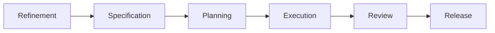

# Tevrin documentation

Tevrin coordinates specialised AI agents through a governed software lifecycle: Refinement, Specification, Planning, Execution, Review and Release. It turns an idea into released software with versioned artifacts, approval gates, rollback and an audit trail. It is for engineers and project owners who want AI-driven delivery with deterministic state and human oversight. The code is source available on GitHub under the [PolyForm Shield License 1.0.0](https://github.com/BenFielder1/AI-Driven-Engineering-Platform/blob/main/LICENSE.md).

Tevrin was called AIDE before version 0.6.0. Some internal identifiers keep the `aide` name. See [Architecture](reference/architecture.md).

## Where to start

| If you want to | Go to |
| --- | --- |
| Run it on your machine | [Getting started](getting-started/index.md) |
| Connect GitHub, an LLM or a tracker | [Guides](guides/index.md) |
| Run it on Kubernetes or Railway | [Operations](operations/index.md) |
| Look up a setting, API or error code | [Reference](reference/index.md) |
| See what changed in each version | [History](history/index.md) |
| Use the logo and colours | [Brand](brand.md) |

## The lifecycle

Agents write artifacts. People approve them at gates. Every state change is logged and can be rolled back. A repository with code can start in an Analysis phase that infers its stack.

## Source of truth

The spec is the source of truth for behaviour. The current spec and build log are [SPEC.md](https://github.com/BenFielder1/AI-Driven-Engineering-Platform/blob/main/SPEC.md) and [PROGRESS.md](https://github.com/BenFielder1/AI-Driven-Engineering-Platform/blob/main/PROGRESS.md). Earlier versions are under [History](history/index.md).
