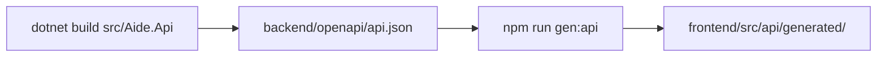

# API and contract

## The contract

`backend/openapi/api.json` is the API contract. It is generated, committed and never hand-edited.

- The frontend calls the backend only through the generated client (`openapi-typescript` and `openapi-fetch`), at same-origin `/api`. No hard-coded hosts.
- API changes are additive unless the spec records a breaking-change decision.
- CI fails if the contract or the client differ from what the code generates (`scripts/ci/check-generated.sh`).

## Conventions

| Topic | Rule |
| --- | --- |
| Prefix | Routes live under `/api`, including the SignalR hub at `/api/hubs/` |
| Health | `/api/health/live` and `/api/health/ready`. Ready fails while migrations are pending |
| Errors | RFC 9457 problem details with an `errorCode` extension. See [Error codes](error-codes.md) |
| Auth | A session cookie (`aide.auth`) with an antiforgery token header for browsers, or a bearer API token (`aide_pat_...`) for the CLI |
| Concurrency | Edited aggregates carry a version, and a stale write returns 409 `CONFLICT` |
| IDs and times | UUID v7 keys, UTC timestamps |
| Stack options | `POST /api/stack/options` and `/validate` return compatibility answers computed in the backend |

## Create an API token

Open **Account** in the app and create a token. It is shown once. Use it with the [CLI](../guides/cli.md) or send it as a bearer token.
