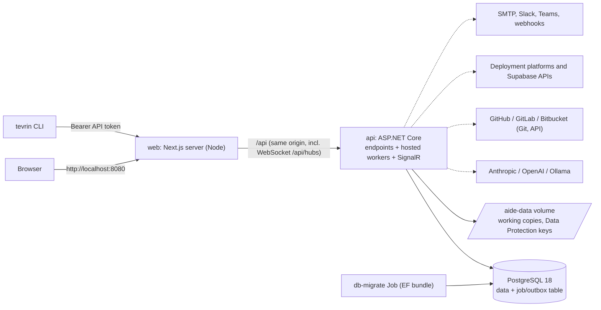

# Architecture

Tevrin's own stack: Next.js 16 (React 19, TypeScript strict) behind a custom Node server, an ASP.NET Core API on .NET 10 with hosted background workers, EF Core 10 on PostgreSQL 18, deployed to Railway and runnable on Docker Desktop Kubernetes. The packs and shared conventions are in [STACK.md](https://github.com/BenFielder1/AI-Driven-Engineering-Platform/blob/main/STACK.md).

This is separate from the stack catalog, which describes the stacks of the projects Tevrin builds.

## How it fits together

- One API process runs the endpoints and the background workers. Workers claim jobs from a PostgreSQL table with `FOR UPDATE SKIP LOCKED`. There is no Redis or message broker (SPEC D1).
- State changes and their follow-up jobs are written in one transaction (outbox).
- Live updates use one SignalR hub, so run a single API replica.
- The frontend calls the API only through the generated client, at same-origin `/api`. The web server (`frontend/server.ts`, a custom Node server around Next.js) proxies it, WebSocket upgrades included, to `BACKEND_URL`. It also sets the security headers and CSP nonce, and logs one redacted JSON line per request, except static assets and `/healthz`.
- On Kubernetes, `deploy-local.sh` runs the `db-migrate` Job (an EF Core bundle in the API image) and waits for it before it updates the API and web pods. A failed migration leaves the running version untouched.

## Business rules and the contract

Business rules live in `Aide.Domain`: pure, unit-tested, with no EF or ASP.NET. Endpoints stay thin. Project lifecycle changes go only through the domain state machine. Artifacts are immutable once locked. LLM calls sit behind one provider abstraction and are faked in tests.

The contract flows one way. The backend build writes `backend/openapi/api.json`, then `npm run gen:api` writes `frontend/src/api/generated/`. Never hand-edit either. See [API and contract](api-and-contract.md).

## Stack catalog and origin model

Merge and deployment polls are self-deferring jobs in the same table, so a restart resumes them. The stack catalog (`Aide.Infrastructure/Agents/Stack`: `catalog.json`, `packs/`, `agents/`, `core/`) is content-hashed, and each release version pins the composition and catalog version it was built with.

- The Domain owns the compatibility rules. `POST /api/stack/options` and `/validate` serve the wizard, Settings, the API and the CLI.
- The origin model says how the browser reaches the backend: `same-origin`, `proxy` or `cross-origin`. The options depend on the chosen frontend, backend and hosts.

## Migrations

- Schema changes are EF Core migrations. Never edit a committed migration.
- Tevrin's own migrations run as an EF bundle: in the `db-migrate` Job on Kubernetes, or as the pre-deploy command on Railway.
- For projects Tevrin builds, Tevrin itself runs only Supabase BaaS migrations, just before the merge. For ORM stacks, the platform runs the data pack's migrate command (pre-deploy, container start, or the production build when `AIDE_RUN_MIGRATIONS=true`).

## Internal names

The product is called Tevrin, but identifiers that would break sessions, tokens, stored data or infrastructure keep the `aide` name: the `Aide.*` projects and namespaces, the `aide` database and user, `aide.*` cookies, `aide_pat_` tokens, `X-AIDE-*` webhook headers, server environment variables and the Kubernetes, Docker and Railway resource names.
